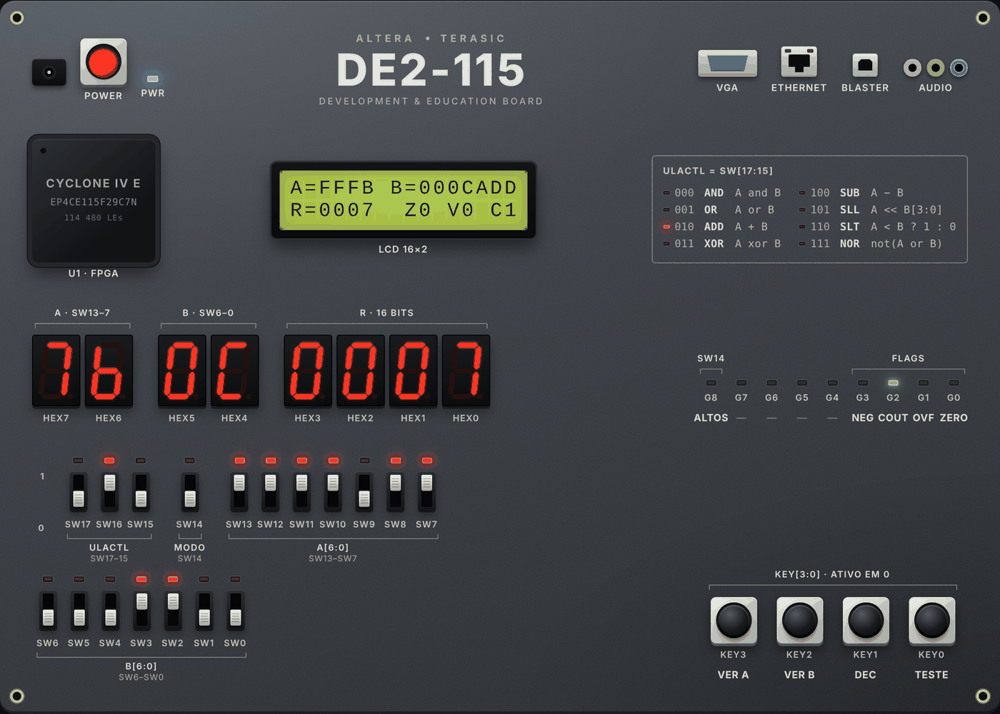

# ULA na DE2-115

Simulador interativo de uma Unidade Lógica e Aritmética (ULA) de 16 bits rodando numa placa FPGA **Terasic DE2-115** desenhada no navegador. Você mexe nas chaves, aperta os botões e vê o resultado nos displays de 7 segmentos, nos LEDs e no LCD, como se estivesse com a placa na bancada.



Feito em HTML, CSS e JavaScript puros. Não precisa de dependências, build nem servidor.

## Como rodar

```bash
git clone <url-do-repositório>
cd ula-de2-115
```

Depois abra o `index.html` no navegador, com dois cliques ou arrastando para uma aba. Funciona direto do disco (`file://`).

As fontes vêm do Google Fonts. Sem internet, a página usa fontes do sistema e continua funcionando.

## Primeiros passos

1. Clique no botão vermelho **POWER**. A placa faz um autoteste de cerca de 2 segundos, com todos os LEDs e segmentos piscando.
2. Escolha a operação nas chaves **SW17–SW15**. A tabela no canto da placa mostra os códigos, e o LED ao lado indica a operação ativa.
3. Monte o operando **A** em **SW13–SW7** e o **B** em **SW6–SW0**. A chave para cima vale 1.
4. Leia o resultado em **HEX3–HEX0** (hexadecimal) e as flags nos LEDs verdes.

A placa já liga com um exemplo: `A = −5`, `B = 12` e operação ADD, que dá `R = 0x0007` com **Cout = 1**.

Abaixo da placa, a **sonda lógica** mostra A, B e R bit a bit (em hex, sem sinal e com sinal) e explica em texto por que cada flag acendeu ou não.

## Mapa de entradas e saídas

### Entradas

| Componente | Função |
|---|---|
| SW17–SW15 | ULACtl: seleciona a operação (3 bits) |
| SW14 | Modo de extensão de A e B: 0 = extensão de sinal, 1 = bits altos |
| SW13–SW7 | A[6:0] |
| SW6–SW0 | B[6:0] |
| KEY3 | Segurar: mostra A com 16 bits em HEX3–0 |
| KEY2 | Segurar: mostra B com 16 bits em HEX3–0 |
| KEY1 | Segurar: mostra R em decimal com sinal em HEX7–0 |
| KEY0 | Segurar: teste de lâmpadas (acende tudo) |
| POWER | Liga e desliga a placa |

Os botões KEY são momentâneos: a função vale enquanto estiverem pressionados. Também funcionam pelo teclado, com Tab até o botão e Espaço ou Enter.

### Saídas

| Componente | Função |
|---|---|
| HEX7–HEX6 | Valor das chaves de A (7 bits, em hex) |
| HEX5–HEX4 | Valor das chaves de B (7 bits, em hex) |
| HEX3–HEX0 | Resultado R (16 bits, em hex) |
| LEDG0 | Zero: R = 0 |
| LEDG1 | Overflow: estouro com sinal em ADD ou SUB |
| LEDG2 | Cout: carry-out (ou último bit que saiu no SLL) |
| LEDG3 | Negativo: R[15] |
| LEDG8 | Modo bits altos ativo (SW14 = 1) |
| LEDR17–LEDR0 | Repetem o estado de cada chave |
| LCD 16×2 | A, B e R em hex, a operação e as flags |

### Extensão de 7 para 16 bits

São só 18 chaves, então A e B entram com 7 bits cada e a placa completa os outros 9:

- **Extensão de sinal** (SW14 = 0): o bit 6 é copiado para os bits 15–7. A e B ficam entre −64 e 63. Nesse intervalo a soma e a subtração nunca estouram, então o Overflow não acende.
- **Bits altos** (SW14 = 1): A[6:0] vai para os bits 15–9 e os bits de baixo ficam em zero. Os valores ficam grandes o bastante para provocar Overflow e Cout.

## Operações

| ULACtl | Operação | Resultado | Flags que podem acender |
|---|---|---|---|
| `000` | AND | `A and B` | Zero, Negativo |
| `001` | OR | `A or B` | Zero, Negativo |
| `010` | ADD | `A + B` | Zero, Overflow, Cout, Negativo |
| `011` | XOR | `A xor B` | Zero, Negativo |
| `100` | SUB | `A − B` | Zero, Overflow, Cout, Negativo |
| `101` | SLL | `A << B[3:0]` | Zero, Cout, Negativo |
| `110` | SLT | `1` se `A < B` (com sinal), senão `0` | Zero |
| `111` | NOR | `not (A or B)` | Zero, Negativo |

Detalhes que valem anotar:

- **SUB** é calculada como `A + not(B) + 1`. Por isso **Cout = 1 quando não há empréstimo**, isto é, quando A ≥ B sem sinal. É a convenção de ARM e de boa parte dos livros de arquitetura.
- **Overflow** só acende em ADD e SUB, quando o resultado com sinal sai de −32768…32767.
- **SLL** desloca A para a esquerda pelos 4 bits baixos de B (0 a 15 posições), com zeros entrando pela direita. Cout guarda o último bit que saiu.
- **XOR** com A = B dá zero, então o Zero também serve para testar igualdade.

## Estrutura do projeto

```
ula-de2-115/
├── index.html        marcação estática da placa e dos painéis
├── css/
│   ├── base.css      tokens de cor e fonte, página
│   ├── board.css     placa e componentes (displays, LEDs, chaves, botões, LCD)
│   └── panels.css    sonda lógica e mapa de E/S
├── js/
│   ├── ula.js        lógica da ULA: tabela de operações, extensão, cálculo e flags
│   ├── seg7.js       codificação de 7 segmentos e SVG de um dígito
│   ├── board.js      monta a placa no DOM e pinta um "quadro" nas saídas
│   ├── probe.js      painel da sonda lógica e explicações em texto
│   └── main.js       estado, leitura das chaves, autoteste e botões
└── docs/
    └── placa.png     captura de tela usada neste README
```

### Como as partes conversam

```
chaves/botões ──► main.js ──► ula.js (A, B, ULACtl → R e flags)
                    │
                    ├──► board.js  (quadro → displays, LEDs, LCD)
                    └──► probe.js  (bits, flags e explicação)
```

- `ula.js` não toca no DOM: recebe números e devolve números. Dá para testar no Node sem navegador.
- `board.js` não sabe o que é uma ULA. Ele recebe um **quadro**, um objeto com o estado de cada saída (`hex[8]`, `ledr[18]`, `ledg[9]`, `lcd[2]`…), e só desenha. O autoteste, o teste de lâmpadas e a operação normal são quadros diferentes passados para a mesma função.
- Os scripts são carregados nesta ordem no `index.html`: `ula → seg7 → board → probe → main`. Eles compartilham o objeto global `window.DE2`. Não são módulos ES de propósito, porque módulos não carregam via `file://`.

## Adicionando ou trocando uma operação

Só o `js/ula.js` muda. Por exemplo, para trocar SLL por SRA (deslocamento aritmético à direita):

1. Edite a entrada em `OPS`, que define o nome e a fórmula exibidos na placa:
   ```js
   { code: 5, m: 'SRA', fx: 'A >> B[3:0]' },
   ```
2. Edite o `case` correspondente em `compute()`:
   ```js
   case 5:
     n = B & 0xF;
     R = (s16(A) >> n) & MASK;
     C = n ? (A >> (n - 1)) & 1 : 0;
     break;
   ```

`Zero` e `Negativo` são calculados automaticamente a partir de `R`. `Cout` e `Overflow` ficam em 0, a menos que o `case` os defina.

Se quiser que a sonda lógica explique a operação nova, acrescente um `case` em `explain()`, no `js/probe.js`.

## Fidelidade com a placa real

| Igual à DE2-115 | Diferente |
|---|---|
| 18 chaves, 4 botões, 8 displays, 18 LEDs vermelhos e 9 verdes | O POWER real é uma chave, não um botão |
| Botões KEY ativos em 0 (rótulo na placa) | Os displays aqui usam 1 = aceso; na placa os segmentos são ativos em 0 |
| LCD 16×2 com caracteres de 5×8 | Conectores (VGA, Ethernet, USB, áudio) são só decorativos |
| FPGA Cyclone IV E EP4CE115F29C7 | O autoteste é uma animação, não o programa de fábrica |

## Acessibilidade

- Todas as chaves e botões são `<button>` com rótulo descritivo e estado `aria-pressed`, e funcionam pelo teclado.
- Com **reduzir movimento** ativo no sistema, o autoteste acende tudo de uma vez em vez de piscar, e as transições são desligadas.
- O layout se reorganiza em coluna única em telas estreitas.

## Testando a lógica no Node

```bash
node -e "
global.window = {};
require('./js/ula.js');
const { ula } = window.DE2;
const A = ula.extend(0b1111011, 0);   // −5
const B = ula.extend(0b0001100, 0);   // 12
console.log(ula.compute(A, B, 2));    // ADD → { R: 7, C: 1, V: 0, Z: 0, N: 0, ... }
"
```

---

*Altera, Terasic e DE2-115 são marcas de seus respectivos donos. Este projeto não tem relação com elas.*